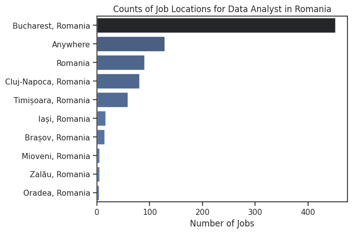
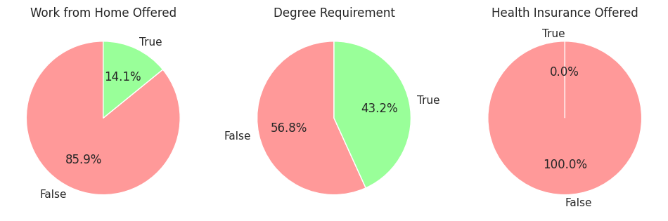
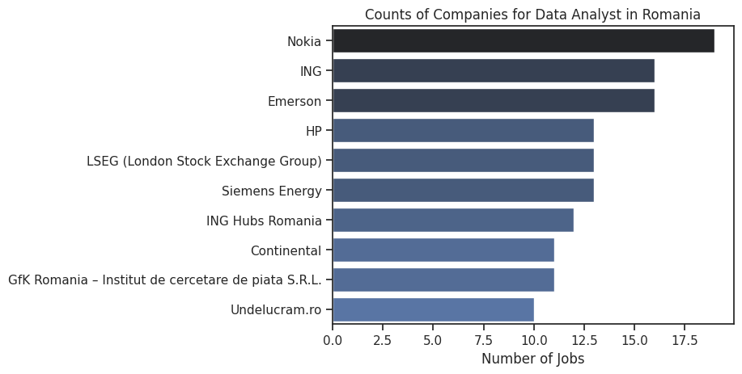
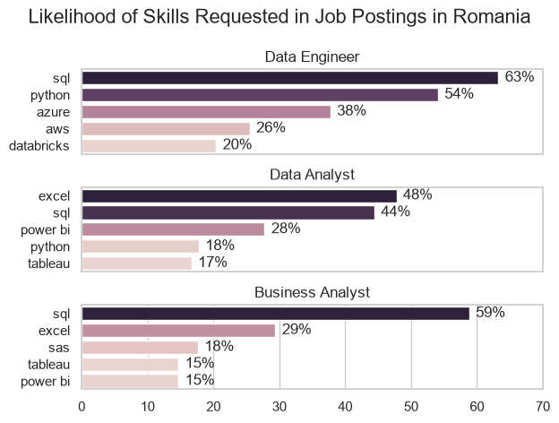
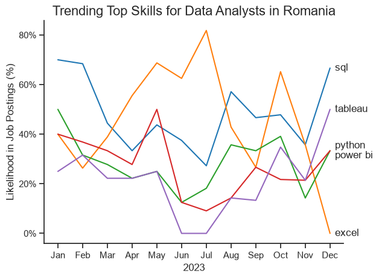
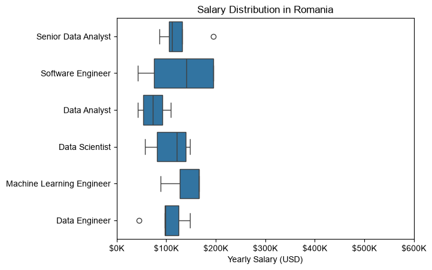
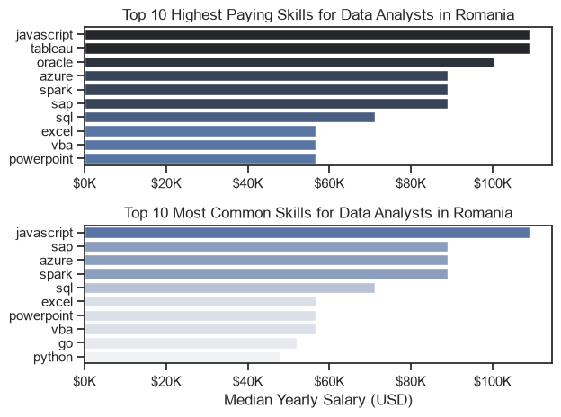
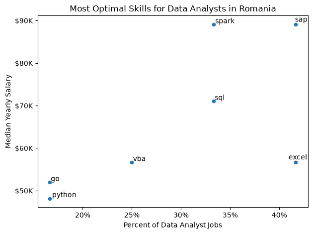

# Overview

This is my analysis of the data job market, with a focus on data analyst roles. This project was created out of a desire to better understand the job market and to help find optimal job opportunities for data analysts.a

I used the data from [Luke Barousse's Python Course](https://www.lukebarousse.com/python) as a foundation for this analysis. The dataset contains detailed information on job titles, salaries, locations, and essential skills. Through a series of Python scripts, I explored key questions such as the most demanded skills, salary trends, and the intersection of demand and salary in data analytics.

# Used Tools
- **Python:** A few popular Python libraries were helpful in my analysis:
  - **Pandas:** Used to clean up and analyze the data.
  - **Matplotlib:** Good for data visualization.
  - **Seaborn:** Made even more advanced visualization.
- **Jupyter Notebook:** Used for interactive code execution, data exploration, and step-by-step documentation of the analytical workflow
- **Visual Studio Code:** The primary code editor used for writing, debugging, and managing the project codebase.
- **Git & GitHub:** Used for version control, tracking project iterations, and hosting the remote repository.

# Data Preparation and Cleanup

To ensure accurate and efficient analysis, the initial dataset required a few critical preprocessing steps before exploration:

* **Data Loading:** Imported the raw dataset [lukebarousse/data_jobs](https://huggingface.co/datasets/lukebarousse/data_jobs/blob/main/data_jobs.csv) using the HuggingFace datasets library and converted it into a Pandas DataFrame for manipulation.
* **Temporal Formatting:** Converted the `job_posted_date` column to `datetime` objects to enable proper time-series and monthly trend analysis.
* **Data Type Parsing:** The `job_skills` column initially contained string representations of lists. I used `ast.literal_eval` to parse these strings back into iterable Python lists, which allowed for proper extraction, exploding, and aggregation of individual skills.

# The Questions

These are the questions I aim to answer in this project:

1. What are the most demanded skills for the top 3 most popular data roles in Romania?
2. How are in-demand skills trending for Data Analysts?
3. How well do jobs and skills pay for Data Analysts?
4. What are the optimal skills for data analysts to learn? (High Demand AND High Paying)

# Initial Exploratory Analysis

First, I decided to have a look at the broader landscape of the Data Analyst job market in Romania to understand the geographic distribution, working conditions, and top employers before diving into the core questions.

### Geographic Distribution of Roles
The market is heavily concentrated in the capital, with Bucharest exceeding 400 job postings. This is followed by flexible options ("Anywhere" and generic "Romania" postings) and major IT hubs like Cluj-Napoca and Timișoara, while cities like Iași and Brașov have significantly fewer listings.



*Bar chart displaying the distribution of job locations for Data Analyst roles in Romania.*

### Work Conditions, Education, and Benefits
Next, I explored the working conditions and base requirements:
* **Work from Home:** Only 14.1% of the analyzed postings explicitly offer a work-from-home option.
* **Education Requirements:** A higher education degree is explicitly required in 43.2% of the cases.
* **Health Insurance:** The data shows that none of the jobs offer health insurance. This is easily explained by the fact that public health insurance is mandatory by law and automatically deducted from the gross salary in Romania. Furthermore, tech companies typically offer private medical clinic subscriptions as a standard benefit, which is likely not captured under the classic "Health Insurance" tag in this dataset.



*Pie charts illustrating the percentage of jobs offering work from home, requiring a degree, and providing health insurance.*

### Top Hiring Companies
I also looked at which companies are driving the most demand. Nokia leads with the highest number of open Data Analyst positions, followed closely by ING and Emerson. 


*Bar chart showing the top companies hiring Data Analysts in Romania based on the number of job postings.*

# The Analysis

## 1. What are the most demanded skills for the top 3 most popular data roles in Romania?

To find the most in demand skills for the top 3 most popular data roles, I filtered the positions by popularity and selected the 5 most common skills for each one. These insights highlight what aspiring data professionals should focus on depending on their target career path.

You can view my notebook with the detailed steps here: [2_Skills_Count.ipynb](2_Skills_Count.ipynb)

### Visualize Data:
```python
fig, ax = plt.subplots(len(job_titles), 1)

sns.set_theme(style="whitegrid", palette="flare")

for i, job_title in enumerate(job_titles):
    df_plot = df_skills_perc[df_skills_perc['job_title_short'] == job_title].head(5)
    sns.barplot(data=df_plot, x='skill_percent', y='job_skills', ax=ax[i], hue='skill_count')
    ax[i].set_title(job_title)
    ax[i].set_ylabel('')
    ax[i].set_xlabel('')
    ax[i].set_xlim(0, 70)
    ax[i].legend().set_visible(False)
    
    for index, value in enumerate(df_plot['skill_percent']):
        ax[i].text(value + 1, index, f'{value:.0f}%', va='center')
    
    if i != len(job_titles) - 1:
        ax[i].set_xticks([])

fig.suptitle('Likelihood of Skills Requested in Job Postings in Romania', fontsize=16)
fig.tight_layout(h_pad=1)
plt.show()
```

### Results:


### Insights:
- **Python** is a good skill to have for its overall versatility, but not the most in demand for these particular roles.
- **SQL** is the most requested skill with the exception of Data Analysts, where **Excel** wins by a small margin.
- **Data Engineers** require heavy cloud infrastructure stack skills (Azure, AWS, Databricks), while analysts focus on BI dashboards and reporting (Excel, Power BI, Tableau, SAS).
- **Power BI** and **Tableau** seem to be equally as important. Chosing to focus on one of them instead of attempting to master both can be a good idea.
- **Data Scientists** are not in the top 3 most popular data roles in Romania yet. Their absence here indicates that the Romanian data market is more focused on business intelligence.

## 2. How are in-demand skills trending for Data Analysts?

It's important to know whether the most common skills for Data Analysts are growing in popularity or, on the contrary, losing their importance. To obtain this data, I had another look at the job postings in Romania in 2023, this time looking at each month separately.

You can view the detailed steps for this analysis here: [3_Skills_Trend.ipynb](3_Skills_Trend.ipynb)

### Visualize Data:
```python
from matplotlib.ticker import PercentFormatter

df_plot = df_DA_RO_perc.iloc[:, :5]
sns.lineplot(data=df_plot, dashes=False, legend='full', palette='tab10')

ax = plt.gca()
ax.yaxis.set_major_formatter(PercentFormatter())

plt.show()
```

### Results:


*Bar graph visualizing the trending top skills for data analysts in Romania in 2023.*

### Insights:
- **SQL** was the most consistently demanded skill throughout 2023.
- All skills showed an increase in demand at the end of the year except for **Excel**, which had an unexpected drop around December.
- It's hard to tell if **Power BI** or **Tableau** is better considering how much they fluctuate in importance. Overall, they are similar.

## 3. How well do jobs and skills pay for Data Analysts?
To identify the highest-paying roles and skills, I selected the jobs only in Romania and looked at their median salary. Before that, I also looked at the salary distributions of common data jobs like Data Scientist, Data Engineer, and Data Analyst, to get an idea of which jobs are paid the most.

View my notebook with the detailed steps for this section here: [4_Salary_Analysis.ipynb](4_Salary_Analysis.ipynb)

### A Salary Analysis

### Visualize Data:
```python
sns.boxplot(data=df_RO_top6, x='salary_year_avg', y='job_title_short', order = job_order)
sns.set_theme(style='ticks')

plt.title('Salary Distribution in Romania')
plt.xlabel('Yearly Salary (USD)')
plt.ylabel('')
plt.xlim(0, 600000)
ticks_x = plt.FuncFormatter(lambda x, pos: f'${int(x/1000)}K')
plt.gca().xaxis.set_major_formatter(ticks_x)
plt.show()
```

### Results:


*Box plot visualizing the salary distributions for the top 6 data job titles.*

### Insights:
- **Software Engineer** salary distributions have the widest spread, spanning from roughly $60K up to $190K USD. This high variance can have many causes such as company size, experience levels, or remote B2B/contracting opportunities common in Romania.
- **Machine Learning Engineer** and **Software Engineer** roles have higher median salaries compared to analytical roles. ML Engineers show a consistently high base salary range (clustering tightly around $130K–$160K USD).
- **Data Engineers** enjoy a solid salary floor starting around $80K USD, outearning baseline **Data Analysts** (with a median around $75K USD). This aligns with earlier findings showing Data Engineers require more specialized cloud and technical stacks.
- Moving from **Data Analyst** to **Senior Data Analyst** or pivoting to **Data Scientist** nearly doubles the median earning potential, raising base expectations from around $75K USD toward $110K–$125K USD.
- Regarding outliers, the **Senior Data Analyst** data shows a high outlier reaching near $200K USD, which could reflect specialized international or remote consulting contracts within Romania. The **Data Engineer** section also features a low outlier near $45K USD, pointing to entry-level or non-standard localized postings.

### Highest Paid & Most Demanded Skills for Data Analysts

### Visualize Data:
```python
fig, ax = plt.subplots(2, 1)

# Top 10 highest paying skills for Data Analysts in Romania
sns.barplot(data=df_DA_top_pay, x='median', y=df_DA_top_pay.index, hue='median', ax=ax[0], palette='dark:b_r')

# Top 10 most common skills for Data Analysts in Romania
sns.barplot(data=df_DA_skills, x='median', y=df_DA_skills.index, hue='median', ax=ax[1], palette='light:b')

plt.show()
```

### Results:


*Two separate bar graphs visualizing the highest paid skills and most in-demand skills for data analysts in Romania.*

### Insights:
- More niche skills like **JavaScript** and **Tableau** top the chart around $110K USD, followed closely by enterprise and big data platforms like **Oracle, Azure, Spark,** and **SAP**. Specialized skills carry a distinct premium over traditional office tools.
- There is significant overlap between the two lists. High-paying enterprise tech like **JavaScript, SAP, Azure,** and **Spark** also feature prominently among the most common skills, showing that Romanian employers actively pay top dollar for infrastructure and web-data-capable analysts.
- Core analysis tools like Excel, VBA, and PowerPoint are the backbone of the market, but cluster near the lower end of the median salary spectrum (around $56K USD). They are fundamental, but mastering them alone yields lower compensation ceiling compared to cloud and software platforms.
- General-purpose programming languages like **JavaScript** (~$110K) and **Go** (~$52K) show varying salary medians, while **Python** sits around $48K USD in median salary for analyst positions. This suggests that Data Analysts that incorporate web scripting/full-stack data integration or backend data tools see higher compensation than entry-level Python script users.

## 4. What are the optimal skills for data analysts to learn? (High Demand AND High Paying)

To identify the most optimal skills to learn ( the highest paid and highest in demand), I calculated the percent of skill demand and the median salary of these skills.

View my notebook with the detailed steps here: [5_Best_Skill.ipynb](5_Best_Skill.ipynb)

### Visualize Data:
```python
from adjustText import adjust_text
import matplotlib.pyplot as plt

plt.scatter(df_DA_skills_high_demand['skill_percent'], df_DA_skills_high_demand['median_salary'])
plt.show()
```

### Results:


*A scatter plot visualizing the optimal skills (high paying & high demand) for Data Analysts in Romania.*

### Data Limitations & Transparency Note
Unlike broader international markets (such as the US), a majority of job postings in Romania do not publicly disclose salary ranges. While the **demand percentage** reliably reflects market popularity across the full dataset, **salary metrics** should be interpreted as indicators for specialized premium compensation rather than guaranteed base averages.

### Insights:
- **SAP** sits at the top right of the matrix (~42% demand, ~$89K USD salary), making it the #1 most optimal skill for high-earning Data Analysts in Romania.
- **Spark** also provides high compensation (~$89K USD) with strong market demand (~33%), showing that analysts with big data/engineering crossover capabilities command premium pay.
- **Excel** also leads in job availability, making it essential for entering the market. However, its compensation ceiling (~$57K USD) is on the lower side.
- **Python** and **Go** sit in the lower-left quadrant (only ~17% demand, ~$48K–$52K USD). In the Romanian job market, standard Data Analyst roles lean more heavily on BI and database tools than standalone programming languages.

# Conclusions

### Summary of Findings
This analysis provides a clear picture of the Data Analyst job market in Romania, offering actionable insights for professionals looking to enter or advance in the field:

- **Market Landscape & Location:** The market is overwhelmingly centralized in **Bucharest**, though flexible/remote roles and regional IT hubs like Cluj-Napoca and Timișoara offer solid alternatives. While remote work is available, the majority of postings still favor on-site or hybrid arrangements.
- **Core vs. Specialized Skills:** Basic tools like **Excel** and **SQL** are non-negotiable entry barriers that guarantee high job availability. However, relying solely on foundational tools caps earning potential around lower median salary ranges.
- **The High-Value Crossover:** The highest-paying opportunities for Data Analysts in Romania lie at the intersection of business intelligence, enterprise systems, and big data. Skills like **SAP**, **Spark**, and **Azure** command significant salary premiums.
- **Market Specifics:** Unlike global trends where Python dominates, the Romanian job market strongly values Business Intelligence (Power BI, Tableau) and enterprise platforms (SAP) over pure programming languages for analytical roles.

### Practical Advice for Data Analysts
- **For Beginners:** Focus first on mastering **SQL** and a core BI tool (**Power BI** or **Tableau**) alongside **Excel**.
- **For Career Growth & Higher Pay:** To move toward top-tier compensation, transition into enterprise ecosystems (**SAP**) or build big data/cloud crossover capabilities (**Spark**, **Azure**).
- **Strategic Focus:** Rather than attempting to learn every tool, pick a high-demand visual tool (Power BI vs. Tableau) and pair it with database and enterprise systems.
